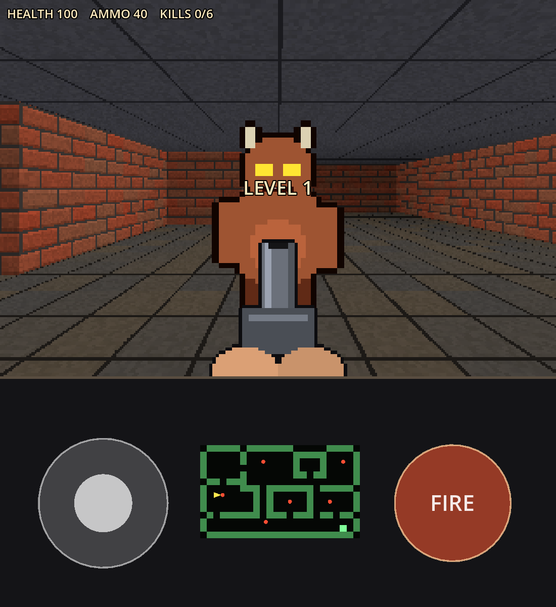

# Fold Blaster

A light Doom-style shooter for the Galaxy Z Fold, made in Godot 4.5.



- **Unfolded:** the game is on top. The bottom panel holds the move stick, an automap and the fire button.
- **Folded (cover screen, sideways):** the controls sit over the game.

The layout switches by itself when you fold or unfold the phone.

All the art and sound is generated in code (`scripts/textures.gd`, `scripts/sfx.gd`), so the project has no asset files.

## Controls

| | Touch | Keyboard / mouse |
|---|---|---|
| Move | Left stick (it appears where your thumb lands) | W A S D or arrow keys |
| Turn | Drag anywhere else | Mouse (click to capture, Esc to release), Q / E, ← / → |
| Fire | FIRE button (slide off it to turn while shooting) | Left click, Space or Ctrl |

Aim assist helps with thumb aiming. Shooting slightly to the side of an enemy still hits it.

## Run it on the laptop

1. Open Godot 4.5, choose **Import**, and select `project.godot`.
2. Press **F5**.

## Make the APK

You need the same setup as Fold Adventure: Godot export templates, JDK 17 and the Android SDK (from Android Studio). In Godot, set the paths under **Editor → Editor Settings → Export → Android**.

1. Go to **Project → Export…**. The **Android** preset is already set up.
2. Click **Export Project** and keep **Export With Debug** ticked. Debug builds are signed automatically with Godot's debug key, which is all you need for your own phone. A release build needs your own keystore, set in the preset's Keystore section.
3. The APK is written to `build/fold-blaster.apk`.

The preset builds both **arm64-v8a** (the real Fold) and **x86_64** (the emulator). For the build you put on your phone, untick x86_64. That roughly halves the APK size.

To install it from the laptop, run `adb install -r build/fold-blaster.apk`, or copy the file to the phone and open it.

## Make your own levels

Levels are text in `MAPS` at the top of `scripts/main.gd`:

```
#  brick wall     %  metal wall     .  floor
P  player start   E  enemy          X  exit
h  health         a  ammo
```

Each row must be the same length and the outside edge must be wall. Add a new list to `MAPS` to add a level. The test checks that each map is valid and that the exit can be reached.

## Project layout

```
scripts/main.gd            game flow, screen layout, levels
scripts/level.gd           builds walls/floor/ceiling from the map, grid pathfinding
scripts/player.gd          movement, shooting, health and ammo
scripts/enemy.gd           enemy AI (chase along the grid, throw fireballs)
scripts/touch_controls.gd  multi-touch stick, fire button, automap panel
scripts/hud.gd             gun, muzzle flash, stats, messages
scripts/fireball.gd, pickup.gd, exit_zone.gd
scripts/textures.gd        procedural pixel art
scripts/sfx.gd             procedural sound effects (autoload "Sfx")
tests/autotest.gd          automated play-through
```

## Tests

```
godot --headless --path . -- --autotest
```

This runs a scripted play-through that covers movement, walls, shooting, aim assist, fireballs, pickups, enemy chasing, both Fold layouts, the touch controls, level change, death and restart, and winning. It prints PASS or FAIL for each check. The `tests/` folder is left out of the APK.

## Ideas for next steps

- Doors and keycards (a `D` tile that slides open)
- A second weapon, such as a shotgun with spread
- More enemy types (a fast melee one, a tougher one)
- Laptop and web exports from the same project (Project → Export → Add…)
